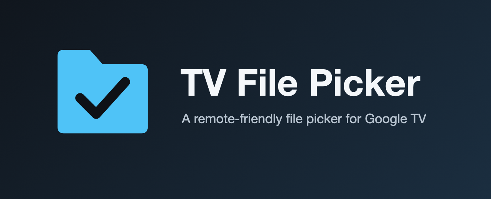
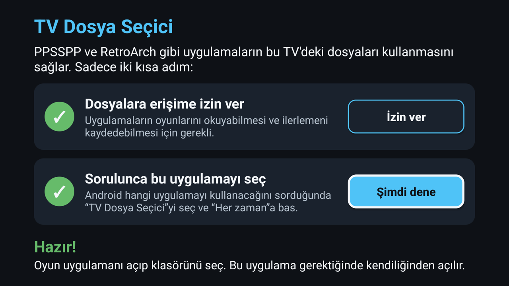
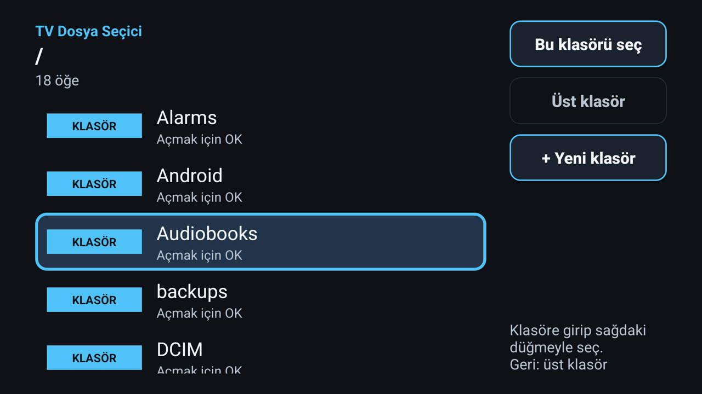

<p align="center"></p>

# TV File Picker

[Türkçe](README.tr.md) | **English**

A remote-friendly file picker and storage provider for Android / Google TV devices that ship without the
system file picker (DocumentsUI). When an app fires `ACTION_OPEN_DOCUMENT`, `ACTION_GET_CONTENT`,
`ACTION_OPEN_DOCUMENT_TREE` or `ACTION_CREATE_DOCUMENT`, this app answers.

The UI follows the device language: English by default, Turkish included. More translations are welcome.

## Screenshots

Taken on a Google TV in Turkish; the UI follows the device language.

| Setup guide | Folder picker |
|---|---|
|  |  |

## What it does

| Intent | Result |
|---|---|
| `OPEN_DOCUMENT` / `GET_CONTENT` | Lets the user pick files. `EXTRA_ALLOW_MULTIPLE` and `EXTRA_MIME_TYPES` are supported. |
| `OPEN_DOCUMENT_TREE` | Lets the user pick a folder and grants persistent read/write access (for apps such as Lemuroid and PPSSPP). |
| `CREATE_DOCUMENT` | Lets the user pick a folder and creates a new file named `EXTRA_TITLE`. |

It also ships a full `DocumentsProvider` (create, rename, delete, move, copy), so apps can keep reading and
writing inside the folder you picked, for example config files, save data and save states.

Internal storage, SD cards and USB drives are all shown. When more than one volume is mounted the picker starts
on a volume list; with only internal storage it opens that directly. The provider is protected by `MANAGE_DOCUMENTS`, so other apps
cannot browse your storage; they only reach what the picker explicitly grants them.

## Install (for users)

1. Download `tv-file-picker-x.y.apk` from the Releases page.
2. Install it on the TV. Two options:
   - **On the TV:** use a file manager or APK installer app (for example Downloader) that has the
     "install unknown apps" permission.
   - **From a computer:** with ADB enabled in the TV's developer options, run
     `adb connect <TV_IP>` and then `adb install -r tv-file-picker-x.y.apk`.
3. Open **TV File Picker** from the apps row. A two-step guide appears and shows a green check when each step is done:
   1. **Allow access to files.** Press the button, find "TV File Picker" in the list that opens, switch it on and press Back.
   2. **Choose this app when asked.** Press "Try it now". When Android asks which app to use, select
      "TV File Picker" and press **Always**.
4. That's it. When a game app asks you to pick a file or folder, this picker opens by itself.

No computer or command line is needed after the install. If your TV has no "all files access" screen,
the app tells you, and the permission can be given once from a computer:
`adb shell appops set com.canalagoz.tvpicker MANAGE_EXTERNAL_STORAGE allow`

## Build (for developers)

Requirements: JDK 17, Android SDK (platform 34, build-tools 34.0.0), Gradle.

```
./deploy.sh <TV_IP>:5555
```

The script builds, installs, grants the permission and checks that the picker is visible to the system.

### Signed release APK

```
keytool -genkeypair -v -keystore tvpicker.jks -alias tvpicker -keyalg RSA -keysize 2048 -validity 10000
export TVPICKER_KEYSTORE=$PWD/tvpicker.jks
export TVPICKER_STORE_PASS=...
export TVPICKER_KEY_ALIAS=tvpicker
export TVPICKER_KEY_PASS=...
./gradlew assembleRelease
```

Never commit `tvpicker.jks` or the passwords.

## Compatibility

| App | Status |
|---|---|
| PPSSPP | Verified: folder selection, settings, in-game saves, save state save/load |
| Lemuroid | Verified: folder selection and opening games (ROM reading) |
| RetroArch | Verified: folder selection lists the folder and its files (press "Always" in the chooser, see Troubleshooting) |
| Saving (`CREATE_DOCUMENT`) | Implemented, not yet tested |
| SD card / USB drive | Implemented, not yet tested on a device |

If you try another app, please open an issue with the app name, version, intent and logcat output.

## Troubleshooting

**The app opens a chooser with "TV File Picker" and "Activity Stub", and RetroArch shows nothing after I pick a folder.**
Many Google TV builds ship an empty placeholder that also answers file-picker intents, so Android asks which one to use.
If you pick "Just once", some apps (RetroArch, for example) never receive the result. Choose **TV File Picker** and
press **Always** once; after that the picker is launched directly and works.

## Limitations

- SD card and USB drive support is implemented but has not been tested on real hardware yet. Reports are welcome.
- Because of Android 11+ package visibility, the calling app may need a `<queries>` entry in its manifest.

## Legal

This project only provides file access. It contains and distributes no games, ROMs or other copyrighted
content. Use it with files you are legally allowed to use. It is not affiliated with Google, PPSSPP or any
other app mentioned here; all names belong to their owners.

## License

[MIT](LICENSE)
