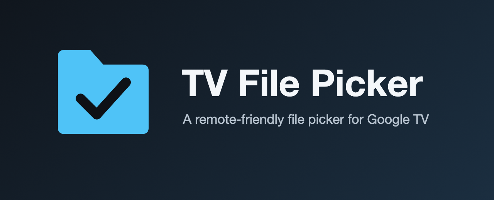
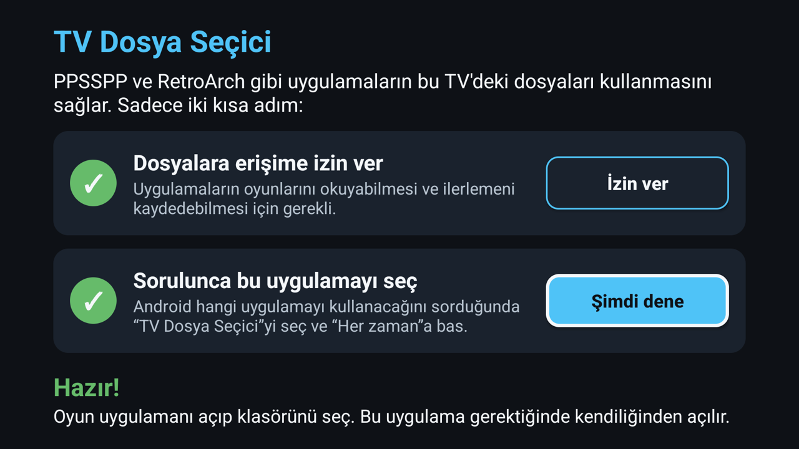
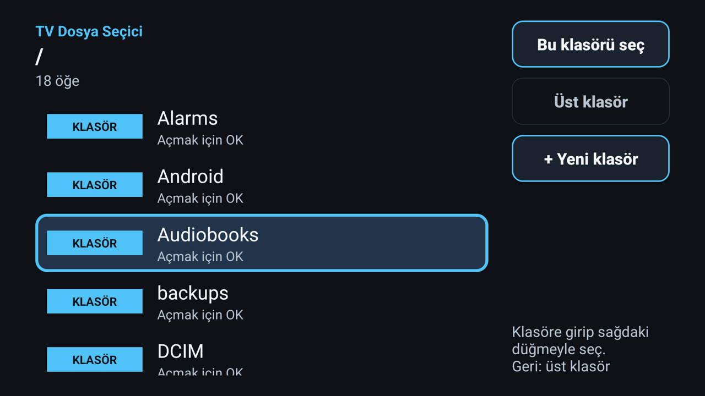

<p align="center"></p>

# TV Dosya Seçici

[English](README.md) | **Türkçe**

Sistem dosya seçicisi (DocumentsUI) olmayan Android TV cihazlar için kumandayla kullanılabilen bir dosya seçici.
Uygulamalar `ACTION_OPEN_DOCUMENT`, `ACTION_GET_CONTENT`, `ACTION_OPEN_DOCUMENT_TREE` ve `ACTION_CREATE_DOCUMENT`
gönderdiğinde bu uygulama cevap verir.

## Ekran görüntüleri

| Kurulum rehberi | Klasör seçici |
|---|---|
|  |  |

## Ne yapar

| Intent | Ne olur |
|---|---|
| `OPEN_DOCUMENT` / `GET_CONTENT` | Dosya seçtirir. `EXTRA_ALLOW_MULTIPLE` ve `EXTRA_MIME_TYPES` desteklenir. |
| `OPEN_DOCUMENT_TREE` | Klasör seçtirir, kalıcı okuma/yazma izni verir (Lemuroid gibi uygulamalar için). |
| `CREATE_DOCUMENT` | Klasör seçtirir ve `EXTRA_TITLE` adıyla yeni dosya oluşturur. |

Dahili depolamayı, SD kartları ve USB belleklerini gösterir. Birden fazla birim takılıysa picker birim listesiyle
açılır; yalnızca dahili depolama varsa doğrudan onu açar. Dışa kapalı sağlayıcı kullanır, diğer uygulamalar
tüm depolamayı göremez; sadece picker'ın verdiği izinle seçilen dosya/klasöre erişir.

## Kurulum (kullanıcı için)

1. Releases sayfasından `tv-file-picker-x.y.apk` dosyasını indir.
2. TV'ye kur. İki yol var:
   - **TV üzerinden:** "bilinmeyen kaynaklardan kurulum" izni olan bir dosya yöneticisi veya APK kurucu
     uygulaması (örneğin Downloader) kullan.
   - **Bilgisayardan:** TV'de geliştirici seçeneklerinde ADB açıksa
     `adb connect <TV_IP>` ve ardından `adb install -r tv-file-picker-x.y.apk`.
3. Uygulamalar satırından **TV Dosya Seçici**'yi aç. İki adımlı bir rehber çıkar, her adım bitince yeşil tik görünür:
   1. **Dosyalara erişime izin ver.** Düğmeye bas, açılan listede "TV Dosya Seçici"yi bul, aç ve Geri'ye bas.
   2. **Sorulunca bu uygulamayı seç.** "Şimdi dene"ye bas. Android hangi uygulamayı kullanacağını sorunca
      "TV Dosya Seçici"yi seç ve **Her zaman**'a bas. Android her istek türü için (dosya açma, dosya kaydetme) bir kez daha sorabilir; her seferinde **Her zaman**'ı seç.
4. Hepsi bu. Bir oyun uygulaması dosya veya klasör seçtirmek istediğinde bu picker kendiliğinden açılır.

Kurulumdan sonra bilgisayara veya komut satırına gerek yok. TV'nde "tüm dosyalara erişim" ekranı yoksa uygulama
bunu söyler; izin bir kez bilgisayardan verilebilir:
`adb shell appops set com.mcanalagoz.tvpicker MANAGE_EXTERNAL_STORAGE allow`

## Geliştirici kurulumu

Gereksinimler: JDK 17, Android SDK (platform 34, build-tools 34.0.0), Gradle.

```
./deploy.sh <TV_IP>:5555
```

Script derler, yükler, izni verir ve picker'ın sistemde görünüp görünmediğini kontrol eder.

### Release sürümleri

Resmi sürümler yapımcı tarafından imzalanır; sorunsuz güncellenen APK'yı almanın tek yeri Releases sayfasıdır.
Kendi sürümünü derlemek için `./gradlew assembleDebug` (debug imzalı) çalıştır veya kendi anahtarınla bir release sürümü imzala
(bkz. `app/build.gradle` içindeki yorumlar). Anahtarlar ve şifreler bu deponun parçası değildir.

## Uyumluluk

| Uygulama | Durum |
|---|---|
| Lemuroid | Klasör seçimi ve oyun açma doğrulandı (ROM okuma) |
| PPSSPP | Doğrulandı: klasör seçimi, ayarlar, oyun içi kayıt ve save state kaydet/yükle |
| RetroArch | Doğrulandı: klasör seçimi klasörü ve dosyalarını listeler (seçim penceresinde "Her zaman"a bas, bkz. Sorun giderme) |
| Kaydetme (`CREATE_DOCUMENT`) | Kodda var, test edilecek |

Yeni bir uygulamayla denediysen sonucu bir issue aç: uygulama adı, sürüm, intent ve logcat çıktısıyla.

## Sorun giderme

**Önüme "TV Dosya Seçici" ve "Activity Stub" seçenekleri çıkıyor, klasör seçtikten sonra RetroArch'ta bir şey olmuyor.**
Birçok Google TV'de dosya seçici isteklerine de cevap veren boş bir yer tutucu var, bu yüzden Android hangisini
kullanacağını soruyor. "Yalnızca bir defa" dersen bazı uygulamalar (örneğin RetroArch) sonucu hiç almıyor.
**TV Dosya Seçici**'yi seçip bir kez **Her zaman**'a bas; sonrasında picker doğrudan açılır ve çalışır.

## Sınırlar

- SD kart ve USB bellek desteği yazıldı ama gerçek cihazda henüz test edilmedi. Geri bildirim memnuniyetle karşılanır.
- Dosya yazma sadece `CREATE_DOCUMENT` ile yeni dosya oluşturmayla sınırlı.
- Android 11+ paket görünürlüğü nedeniyle çağıran uygulamanın manifest'inde `<queries>` tanımı gerekebilir.

## Lisans

[MIT](LICENSE). Uygulamanın bağımlılığı, internet izni, reklamı ve izleyicisi yoktur.

"TV Dosya Seçici" adı, simgesi ve banner'ı lisansa dahil değildir. Resmi sürümler Google Play'deki ve bu deponun sürümler sayfasındakilerdir; bir çatal yayınlarsan lütfen kendi adını, simgeni ve paket adını kullan.

## Yapımcı

[mcalago](https://github.com/mcalago) · [mesutcanalagoz.com.tr](https://mesutcanalagoz.com.tr)

Sorun bildirimleri ve katkılar memnuniyetle karşılanır. Uygulama içindeki **Hakkında** ekranı aynı bilgileri gösterir.
